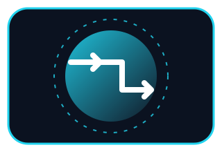

   

## 🚀 Overview

HTTP Redirect Map follows a URL one redirect at a time and prints each response status and Location target. It helps developers diagnose redirect loops, long chains, and accidental HTTPS downgrades.

## ✨ Features

- 🧭 Trace 301, 302, 303, 307, and 308 responses
- 🔗 Resolve relative Location headers correctly
- ♻️ Detect loops and enforce a maximum hop count
- 🔐 Warn when a redirect downgrades HTTPS to HTTP

## 🎬 Demo

~~~bash
python main.py https://example.com --max-hops 8
~~~

The tool sends HEAD requests and does not automatically follow redirects.

## ⚡ Quick Start

~~~bash
git clone https://github.com/CyberLoop-dev/http-redirect-map.git
cd http-redirect-map
python main.py --help
~~~

Python 3.10 or newer is recommended. Network access is needed only for tracing a target URL.

## 🧰 Tech Stack

- 🐍 Python 3.10+
- 📦 Python standard library only
- 🧪 unittest for tests

## 📁 Folder Structure

~~~text
http-redirect-map/
├── assets/icon.svg
├── tests/test_main.py
├── .gitignore
├── LICENSE
├── README.md
├── main.py
├── pyproject.toml
└── requirements.txt
~~~

## 🗺️ Roadmap

- [x] 🧩 Working redirect tracer
- [x] 🧪 Standard-library tests
- [ ] 📊 Optional HTML chain report
- [ ] 🧰 More response edge cases

## 🤝 Contributing

Issues and pull requests are welcome. Keep changes focused, add tests for new behavior, and use clear commit messages.

## 📄 License

Released under the MIT License. See [LICENSE](LICENSE).

